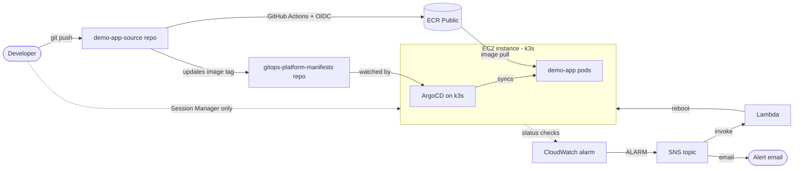

# Self-Healing GitOps Platform on AWS

A small end-to-end DevOps platform: infrastructure as code, Kubernetes, GitOps
deployment, a keyless CI/CD pipeline, and automated instance recovery.

## Architecture



## What is in this repo

| Path | Purpose |
|---|---|
| `main.tf`, `variables.tf`, `providers.tf`, `outputs.tf` | VPC, subnet, security group, IAM role, EC2 instance, Elastic IP |
| `ecr.tf` | ECR Public repository and the GitHub OIDC role (no stored AWS keys) |
| `selfheal.tf`, `lambda/handler.py` | CloudWatch alarm, SNS topic, Lambda that reboots the instance |
| `ansible/` | Roles that configure the server: swap, base packages, k3s, Helm |

Related repos:
- `demo-app-source`: Dockerfile and the GitHub Actions workflow
- `gitops-platform-manifests`: Helm chart and the ArgoCD Application that ArgoCD watches

## How it works

1. **Provision:** Terraform builds the network, server, and IAM roles.
2. **Configure:** Ansible installs k3s and Helm. Re-running it changes nothing (idempotent).
3. **Deploy:** ArgoCD watches the manifests repo and keeps the cluster matching Git. Manual changes get reverted (self-heal).
4. **Build:** a push to `demo-app-source` runs GitHub Actions, which assumes an AWS role through OIDC, pushes the image to ECR Public, and commits the new tag to the manifests repo. ArgoCD then rolls it out.
5. **Recover:** a CloudWatch alarm on the EC2 status check notifies an SNS topic. SNS emails me and triggers a Lambda that reboots the instance.

## Security decisions

- **No SSH from the internet.** Port 22 is closed. Access is through AWS Systems Manager Session Manager, which keeps working when my home IP changes.
- **No long-lived AWS keys in GitHub.** The workflow uses OIDC, and the role trusts only the `demo-app-source` repo on `main`.
- **Least privilege:** the Lambda can reboot only this one instance, and the GitHub role can only push to the one ECR repository.
- **Secrets stay out of Git:** `terraform.tfvars` is git-ignored, and no passwords are committed.
- Every change goes through a branch and pull request into a protected `main`.

## Verified behaviour

- Pushing a code change updates the running app with no manual steps (GitHub Actions, then the manifests repo, then ArgoCD).
- Scaling a deployment by hand gets reverted by ArgoCD to match Git.
- Forcing the CloudWatch alarm into ALARM triggers the Lambda, which reboots the instance. The server came back with all pods running and ArgoCD resynced.

Limits of that last test: forcing the alarm state proves the alarm, SNS, Lambda, reboot path. It does not prove the alarm detects a real fault. A reboot also only helps with a hung operating system, because crashed containers are handled by Kubernetes itself.

## Cost

Lambda, SNS email, CloudWatch alarms, and ECR Public are within AWS free allowances. The full stack (k3s, ArgoCD) needs more memory than a t3.micro has, so it was built and demonstrated on a t3.small, which is not Free Tier. The instance runs only during work sessions and is stopped in between. A billing alert is set.

## Quick start

```bash
terraform init && terraform plan
terraform apply
cd ansible && ansible-playbook site.yml
```

Then register the ArgoCD Application from the manifests repo.

## What I learned

- GitHub's OIDC `sub` claim can include numeric owner and repo IDs. My trust policy used the plain names and AWS denied the role until I printed the real claim in the workflow and matched it exactly.
- Terraform kept rebuilding the instance because `associate_public_ip_address = false` conflicts with an attached Elastic IP. Reading the `# forces replacement` line found it.
- A home ISP using shared (CGNAT) addresses made IP-based firewall rules unreliable, which led to the Session Manager design.

## Next steps

- Add Prometheus and Grafana monitoring
- A second alarm for real failure conditions, such as sustained high CPU
- Move Terraform state to a remote S3 backend with locking
- Add terraform fmt and validate checks to pull requests
